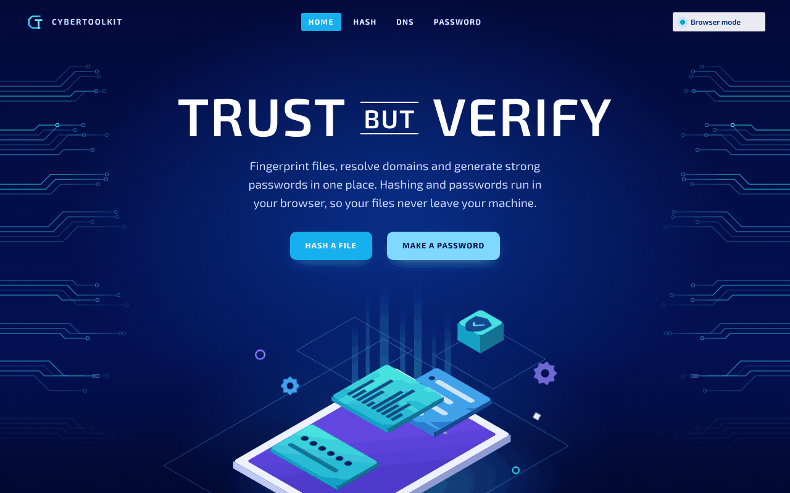

# CyberToolkit

A hands-on defensive security toolkit with two entry points. The web dashboard fingerprints files and text with SHA-256, compares them against a trusted digest, looks up DNS records and generates strong passwords, all from a static page. The Python CLI adds network inspection, streaming hashes for large files, and the same password generator.



## Use the dashboard

The dashboard in [`docs/`](docs/) is a static site, so GitHub Pages can host it with no build step. Once Pages is turned on, it lives at **https://kurt-sudo420.github.io/CyberToolkit/**.

To turn on Pages for this repository:

1. Open **Settings → Pages**.
2. Under **Build and deployment**, set **Source** to **Deploy from a branch**.
3. Choose the **main** branch and the **/docs** folder, then select **Save**.

The site updates a minute or two after each push to `main`.

What runs where:

| Tool | On GitHub Pages | With `webapp.py` |
| --- | --- | --- |
| SHA-256 text and file hashing | In your browser (Web Crypto) | In your browser |
| Password generator | In your browser (`crypto.getRandomValues`) | In your browser |
| DNS lookup | Cloudflare DNS-over-HTTPS | Your system resolver, through the local API |

Text, files and passwords never leave the page. The only outside request the hosted page makes is the DNS-over-HTTPS query, and its content security policy allows nothing else. Fonts are self-hosted under the SIL Open Font License.

To try the static site locally without Python packages:

```sh
python -m http.server 8000 --bind 127.0.0.1 --directory docs
```

Open [http://127.0.0.1:8000](http://127.0.0.1:8000). The three ASCII bytes `abc` (the default text) produce this digest:

```text
ba7816bf8f01cfea414140de5dae2223b00361a396177a9cb410ff61f20015ad
```

Paste it into **Expected SHA-256** to see a match, then change one character to see the difference highlighted. To check a real download, open the **File** tab, choose the file and paste the digest its publisher lists.

## Run the CLI

```sh
python cybertoolkit.py
```

| Menu | Tool | Behavior |
| --- | --- | --- |
| 1 | Port scanner | Checks TCP connections to one IPv4 target with bounded concurrency. Port labels suggest common services. |
| 2 | File hash | Reads a file in chunks and prints its SHA-256 digest. |
| 3 | Password generator | Uses Python’s `secrets` module. Defaults to 20 characters and supports 8–256. |
| 4 | DNS lookup | Lists the addresses returned by the system resolver. |
| 5 | Banner grabber | Reads up to 1,024 bytes with a timeout and escapes terminal control characters. |

Use network probes only on systems you own or have explicit permission to test. For a reproducible exercise, leave the local static server above running and scan `127.0.0.1` on port `8000` from a second terminal. An open port shows that a connection succeeded. It does not establish a vulnerability.

## Run the dashboard with the local API

`webapp.py` serves the same `docs/` page and adds a FastAPI backend, so DNS lookups use your own resolver instead of Cloudflare:

```sh
python -m pip install -r requirements.txt
uvicorn webapp:app --host 127.0.0.1 --port 8000
```

The page detects the API and switches over automatically; the status box in the header reads **Local API** instead of **Browser mode**.

| Endpoint | Purpose |
| --- | --- |
| `GET /api/health` | Liveness check |
| `POST /api/hash` | SHA-256 of `{"text": "..."}` (up to 1,000,000 characters) |
| `GET /api/dns?domain=` | IPv4 and IPv6 addresses for a validated hostname |
| `GET /api/password?length=` | Password of 8–256 characters, default 20 |

Responses carry a strict content security policy, `X-Frame-Options: DENY` and `Cache-Control: no-store` on API routes. The port scanner and banner grabber are intentionally CLI-only so the server can't be used to probe other hosts.

## Verification

Run `python -m unittest discover -v` from the repository root. The tests use local inputs, a simulated remote banner and a mocked resolver, and check that every asset path in `docs/` is relative so the site works under the Pages subpath. The CLI and its tests require Python 3.8+ and use the standard library; the web API tests are skipped unless the packages in `requirements.txt` are installed. The dashboard needs a modern browser and, for hashing, HTTPS or localhost.
